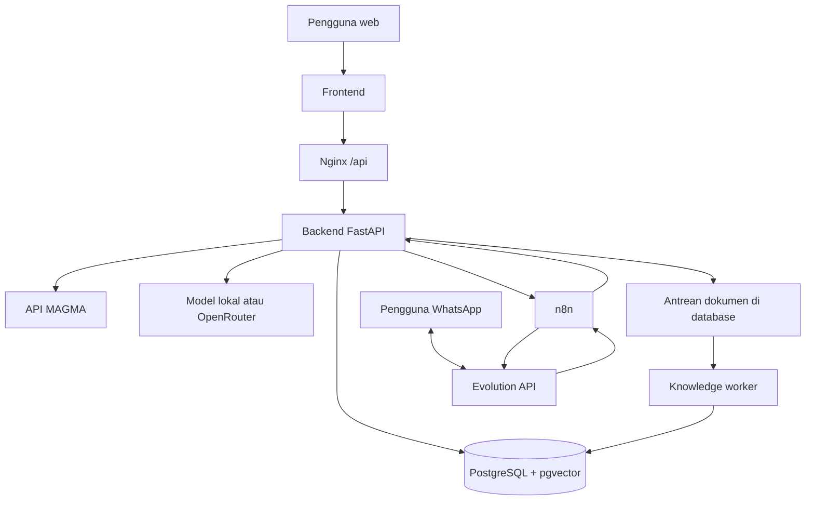
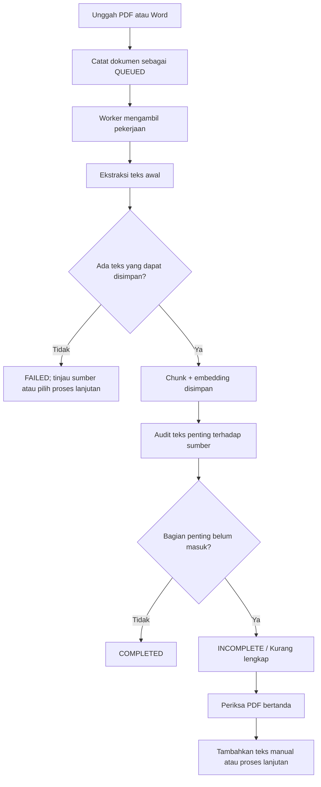

# Dokumentasi Project ESDM Assistant

Dokumen ini menggambarkan implementasi yang ada di `magma-ai-staging` per 1 Oktober 2026. Panduan langkah penggunaan web ada di [USER_GUIDE.md](USER_GUIDE.md). Pengaturan dan penggunaan WhatsApp dijelaskan terpisah di [WHATSAPP_GUIDE.md](WHATSAPP_GUIDE.md).

## 1. Tujuan dan cakupan

ESDM Assistant menyediakan dua cara bertanya melalui web: **API Documentation** untuk informasi kebencanaan dari layanan MAGMA, dan **Knowledge Base** untuk mencari jawaban dari dokumen yang diunggah. Pengguna dapat memilih model bahasa lokal atau OpenRouter. Dokumen yang masuk diproses menjadi potongan teks (chunk) dan embedding agar dapat dicari kembali beserta rujukannya.

Integrasi WhatsApp menambah kanal pertanyaan dan unggah dokumen. Evolution API menghubungkan sesi WhatsApp, sedangkan n8n menerima pesan dan meneruskannya ke endpoint backend yang sesuai. Data kebencanaan yang berubah dari waktu ke waktu tetap perlu diverifikasi terhadap sumber resmi sebelum dipakai untuk keputusan keselamatan.

## 2. Komponen dan arsitektur

| Komponen | Tugas | Sumber konfigurasi |
| --- | --- | --- |
| `fe-esdm` | Antarmuka React/Vite: chat, riwayat, Knowledge Base, detail dokumen, dan pengelolaan API key | `fe-esdm/.env` |
| `ms-esdm` (`backend`) | FastAPI untuk autentikasi, chat MAGMA, tanya dokumen, unggah, audit, dan API dokumen | `ms-esdm/.env` |
| `knowledge-worker` | Mengambil antrean dokumen satu per satu, mengekstrak teks dan membuat embedding; pekerjaan berjalan dalam proses anak agar dapat dihentikan jika dokumen dihapus | `ms-esdm/.env` dan Compose |
| `db` | PostgreSQL 15 dan pgvector untuk dokumen, chunk, embedding, riwayat, dan sesi login WhatsApp | `docker-compose.yml` |
| `openai-local` | Menjalankan model bahasa GGUF lokal melalui API | `openai_local/.env` |
| `nginx` | Mengarahkan `/` ke frontend, `/api/` ke backend, dan `/openai/` ke layanan model lokal | `nginx/nginx.conf` |
| `n8n` | Mengatur alur pesan dan dokumen WhatsApp | Volume `n8n-data`; lihat panduan WhatsApp |
| `evolution-api` | Koneksi WhatsApp, webhook pesan masuk, pengiriman balasan | Compose, volume instance, dan database Evolution |
| `evolution-db`, `evolution-redis` | Penyimpanan dan layanan pendukung Evolution API | Volume Compose |
| `adminer` | Pemeriksaan database lokal | `docker-compose.yml` |



Di web, pengguna memilih sumber sebelum mengirim pertanyaan. Di WhatsApp, workflow menilai isi pesan: pertanyaan kondisi kebencanaan saat ini diarahkan ke `/analyze`, sedangkan pertanyaan proyek atau dokumen diarahkan ke `/knowledge/analyze`. Aturan tersebut berbasis kata kunci pada workflow, sehingga pertanyaan yang ambigu dapat salah jalur; gunakan istilah yang jelas atau periksa sumber jawaban.

### Alasan pemilihan komponen

PostgreSQL dan pgvector menempatkan metadata, riwayat, chunk, serta vektor pencarian dalam satu sistem penyimpanan. Worker terpisah menjaga unggah dan chat tetap dapat merespons saat ekstraksi dokumen berjalan. Model Qwen2.5 1.5B Q4 dipilih untuk keterbatasan komputasi lokal; OpenRouter memberi pilihan model berbasis jaringan ketika hasil lokal belum cukup. n8n memudahkan pemeriksaan cabang pesan dan integrasi HTTP tanpa menaruh seluruh alur di kode backend. Evolution API menjadi penghubung ke sesi WhatsApp sehingga backend tidak perlu menangani protokol WhatsApp secara langsung. Pilihan ini membawa ketergantungan tambahan pada status koneksi, webhook, serta penyimpanan volume n8n dan Evolution.

## 3. Fitur yang sudah dibuat

### Chat web

- Mode **API Documentation** menggunakan pipeline MAGMA untuk pertanyaan gunung api, gempa, dan informasi kebencanaan. Lokasi dapat diaktifkan untuk pertanyaan yang memerlukan posisi pengguna.
- Mode **Knowledge Base** menggunakan hasil pencarian chunk dokumen. Ketik `@` untuk memilih dokumen tertentu; jawaban dapat menyertakan rujukan dokumen.
- Bahasa Indonesia dan Inggris, riwayat percakapan, pertanyaan contoh berikon, serta tata letak desktop dan mobile.
- Pilihan model: `local` (Qwen2.5 1.5B Instruct Q4) dan `openrouter:openrouter/free`. Default API adalah `local`. Pilihan model bahasa tidak mengubah model embedding dokumen.

### Pengelolaan dokumen

- Unggah melalui web menerima `.pdf`, `.doc`, dan `.docx` menurut API. Antarmuka upload membatasi berkas sampai 50 MB; endpoint unggah WhatsApp memiliki batas terpisah 20 MB.
- Dokumen diproses asinkron dengan status `QUEUED`, `PROCESSING`, `COMPLETED`, `INCOMPLETE` (ditampilkan sebagai **Kurang lengkap**), atau `FAILED`.
- Alur ekstraksi standar memeriksa lapisan teks lebih dulu. Hasil pertama yang terbaca disimpan; audit mencatat bagian teks penting yang belum ditemukan. Analisis layout Docling dan OCR adalah pilihan proses lanjutan, bukan langkah otomatis yang selalu berjalan.
- Detail dokumen menampilkan chunk tersimpan, halaman, jumlah huruf sumber dan chunk, cakupan audit, serta daftar bagian penting yang belum masuk jika tersedia.
- **Lihat PDF bertanda** menandai teks yang cocok dengan chunk tersimpan. Berkas Word dikonversi sementara menjadi PDF untuk pratinjau. Perbedaan rendering, teks dalam gambar, atau font dapat membuat teks tertentu tidak tertandai meskipun telah tersimpan.
- Pengguna dapat memilih **Proses lanjutan** untuk pemeriksaan layout tanpa OCR atau OCR, atau **Tambahkan teks manual** dengan nomor halaman. Pemrosesan ulang menggunakan berkas sumber yang sama dan memperbarui hasil tersimpan.
- Penghapusan dokumen menghentikan pekerjaan ekstraksi yang masih berjalan ketika worker mendeteksi bahwa dokumen tersebut sudah tidak ada.

### Integrasi dan operasional

- WhatsApp: pesan teks, unggah dokumen setelah login melalui chat pribadi, serta pemberitahuan hasil pemrosesan dokumen. Rincian dan perintah pengguna: [WHATSAPP_GUIDE.md](WHATSAPP_GUIDE.md).
- Autentikasi web, API key, dan riwayat chat tersedia di aplikasi. Endpoint FastAPI dapat dilihat melalui antarmuka API Documentation.
- Docker Compose menjalankan frontend, backend, worker, database, model lokal, proxy, n8n, dan Evolution API. Volume menyimpan database, instance WhatsApp, serta data n8n; berkas dokumen dan model menggunakan bind mount host.

## 4. Alur unggah dan audit dokumen



Angka cakupan audit mengukur bagian teks penting yang dapat dicocokkan, **bukan** persentase semua huruf dokumen. Jumlah huruf sumber dan jumlah huruf chunk adalah metrik berbeda; chunk dapat memiliki normalisasi atau pengulangan konteks. Dokumen hasil pindai tanpa lapisan teks mungkin memerlukan OCR secara eksplisit dan dapat memakan waktu CPU lebih lama.

## 5. Menjalankan project

Jalankan perintah dari direktori `magma-ai-staging`.

1. Siapkan `ms-esdm/.env`, `fe-esdm/.env`, dan `openai_local/.env` berdasarkan berkas contoh di masing-masing layanan. Isi kredensial yang diperlukan secara lokal. Nilai `VITE_API_URL` harus dapat diakses oleh **browser**; saat mengakses melalui port 80 pada komputer yang sama, gunakan `http://localhost/api`. Variabel `VITE_*` dibenamkan pada saat build frontend.
2. Pastikan bind mount `/mnt/data/magma-ai/blobs` dan `/mnt/data/magma-ai/models` tersedia di host, atau sesuaikan path Compose dengan lokasi berkas Anda. File GGUF untuk model lokal dijelaskan di [openai_local/LOCAL_MODEL.md](openai_local/LOCAL_MODEL.md).
3. Pastikan volume eksternal `magma-ai_esdm-data` tersedia. Konfigurasi saat ini menggunakannya agar database utama tetap memakai data yang sudah ada. **Jangan** membuat volume kosong dengan nama yang berbeda bila Anda ingin mempertahankan dokumen lama.
4. Jalankan `docker compose up -d --build`, lalu periksa `docker compose ps` dan `docker compose logs --tail=100 backend knowledge-worker`.

| Alamat lokal | Fungsi |
| --- | --- |
| `http://localhost/` | Web melalui Nginx |
| `http://localhost:3000/` | Frontend langsung; request API tetap menggunakan URL hasil build |
| `http://localhost/api/docs` | Dokumentasi API backend melalui Nginx |
| `http://localhost:5679/` | n8n, hanya bind ke loopback host |
| `http://localhost:8082/manager` | Evolution Manager, hanya bind ke loopback host |
| `http://localhost:8081/` | Adminer, hanya bind ke loopback host |

Perintah operasional yang aman:

```bash
docker compose ps
docker compose logs --tail=100 backend knowledge-worker
docker compose logs --tail=100 n8n evolution-api
docker compose up -d --build
docker compose down
```

`docker compose down` menghentikan container tanpa menghapus volume. Hindari opsi `-v` ketika data database, workflow, atau sesi WhatsApp masih diperlukan. Untuk langkah pemulihan khusus WhatsApp, lihat [WHATSAPP_GUIDE.md](WHATSAPP_GUIDE.md).

## 6. Keterbatasan yang perlu diketahui

- Dokumen berformat kompleks dan hasil pindai tidak selalu bisa diekstrak penuh pada percobaan awal. Status **Kurang lengkap**, audit, pratinjau bertanda, serta proses lanjutan membantu memeriksanya; tidak ada jaminan semua teks gambar dapat dipulihkan.
- Pembuatan PDF dari Word bergantung pada LibreOffice dan bisa menghasilkan perbedaan halaman dari aplikasi asal.
- Qwen lokal 1.5B dipilih agar dapat berjalan pada perangkat terbatas. Untuk pertanyaan panjang atau konteks sulit, kualitas jawaban perlu diperiksa terhadap dokumen sumber. OpenRouter memerlukan koneksi jaringan dan API key yang sesuai.
- n8n dan Evolution menyimpan konfigurasi runtime di volume Docker. Perubahan workflow atau webhook melalui antarmuka tidak otomatis menjadi berkas version control di repository.
- `DEPLOYMENT_GUIDE.md` dan beberapa label lama pada halaman upload masih memuat contoh yang lebih tua dari Compose dan pipeline saat ini. Untuk layanan dan perilaku yang dijalankan sekarang, rujuk `docker-compose.yml` dan dokumen ini.

## 7. Peta kode

| Kebutuhan | Lokasi |
| --- | --- |
| Route tanya MAGMA | `ms-esdm/routes/v1/analyze.py`, `ms-esdm/services/pipeline_id.py` |
| Route tanya dokumen dan upload | `ms-esdm/routes/v1/knowledge.py` |
| Ekstraksi PDF/Word | `ms-esdm/utils/docling_extractor.py` |
| Audit teks dan PDF bertanda | `ms-esdm/utils/stored_text_audit.py`, `ms-esdm/utils/annotated_pdf.py` |
| Antrean dan pembatalan pekerjaan | `ms-esdm/worker/knowledge_worker.py`, `ms-esdm/worker/document_job.py` |
| Login WhatsApp | `ms-esdm/services/whatsapp_auth_service.py` |
| Antarmuka chat dan dokumen | `fe-esdm/src/pages/ChatRAG.jsx`, `fe-esdm/src/pages/KnowledgeBasePage.jsx`, `fe-esdm/src/pages/DocumentDetailPage.jsx` |

Untuk detail endpoint dan pengujian backend, lihat [API_DOCUMENTATION.md](ms-esdm/documentations/API_DOCUMENTATION.md) dan [TESTING.md](ms-esdm/documentations/TESTING.md). Cocokkan contoh lama di sana dengan route aktual sebelum digunakan.
