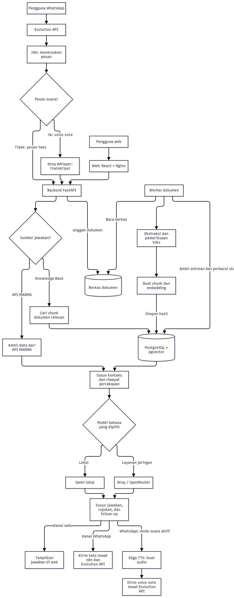
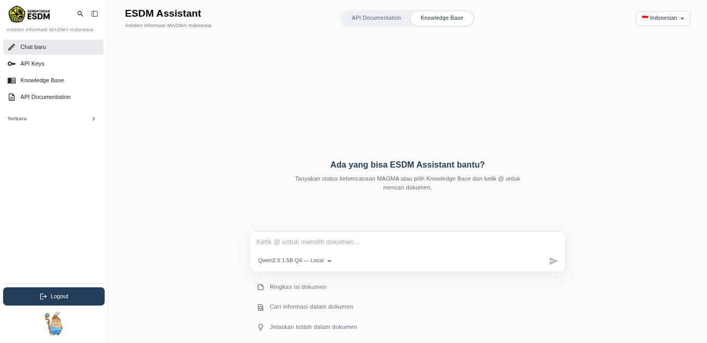
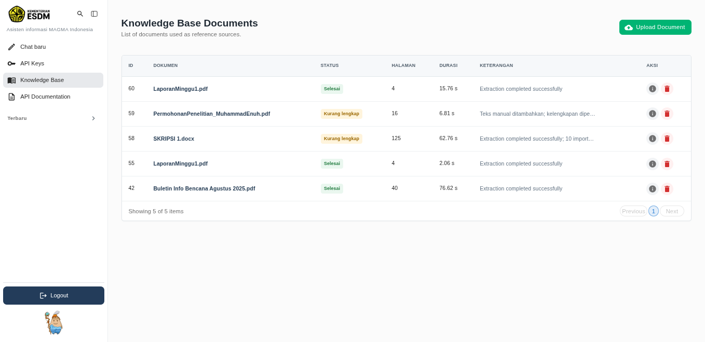
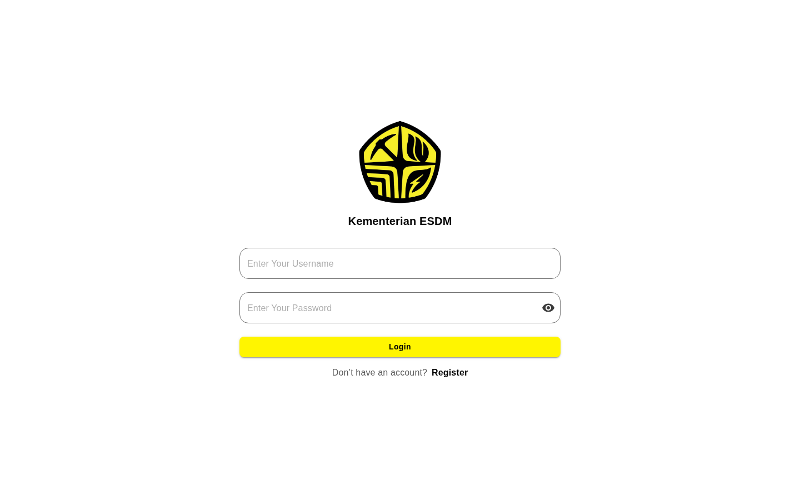

# MAGMA AI - NARA

**MAGMA AI** menyediakan tanya jawab kebencanaan geologi melalui web dan WhatsApp. Asistennya, **NARA**, mengambil informasi dari layanan MAGMA atau dokumen di Knowledge Base. Pengelola dapat memeriksa hasil ekstraksi dokumen sebelum menggunakannya sebagai rujukan.

> **Batas penggunaan:** MAGMA AI - NARA bukan kanal informasi resmi PVMBG. Untuk urusan keselamatan, selalu cocokkan jawaban dengan pengumuman dan rekomendasi resmi.

## Daftar isi

- [Latar belakang dan tujuan](#latar-belakang-dan-tujuan)
- [Kemampuan sistem](#kemampuan-sistem)
- [Arsitektur dan alur sistem](#arsitektur-dan-alur-sistem)
- [Teknologi dan versi](#teknologi-dan-versi)
- [Model AI yang digunakan](#model-ai-yang-digunakan)
- [Endpoint API](#endpoint-api)
- [Preview sistem](#preview-sistem)
- [Struktur repositori](#struktur-repositori)
- [Asal proyek dan atribusi](#asal-proyek-dan-atribusi)
- [Dokumentasi lanjutan](#dokumentasi-lanjutan)
- [Keterbatasan](#keterbatasan)
- [Keamanan dan data](#keamanan-dan-data)

## Latar belakang dan tujuan

Data pemantauan kebencanaan berubah dari waktu ke waktu, sedangkan dokumen menyimpan informasi pada saat penulisannya. NARA memisahkan kedua sumber agar pertanyaan tentang kondisi terkini tidak dijawab dari arsip. Pada dokumen hasil pindai, teks yang gagal terbaca juga perlu diketahui sebelum pengelola memakai dokumen sebagai rujukan.

NARA dibuat untuk:

1. Memudahkan pencarian informasi MAGMA dan isi dokumen lewat percakapan, baik di web maupun di WhatsApp.
2. Memisahkan jalur sumber supaya data terkini tidak tercampur dengan arsip dokumen.
3. Menampilkan rujukan yang tersedia, sekaligus status dan kelengkapan teks dokumen.
4. Menyimpan hasil ekstraksi awal yang sudah bisa dipakai, lalu menyediakan pemeriksaan dan pemrosesan lanjutan bila perlu. OCR yang berat tidak dijalankan otomatis di tahap awal.
5. Memberi pilihan antara model lokal dan model dari penyedia jaringan, sesuai sumber daya dan konfigurasi yang ada.

WhatsApp menjadi kanal tambahan karena penggunaannya luas. Dalam survei GWI kuartal III 2024 yang dimuat pada laporan [Digital 2025 Indonesia](https://wearesocial.com/wp-content/uploads/2025/02/Digital_2025_Indonesia_v02.pdf), **91,7% responden pengguna internet Indonesia berusia 16 tahun ke atas** melaporkan memakai WhatsApp setiap bulan. Angka survei ini mendukung pemilihan kanal WhatsApp; angka tersebut tidak mengukur keberhasilan NARA.

Untuk pertanyaan dokumen, NARA mencari bagian teks yang relevan sebelum model menyusun jawaban. Pendekatan ini dikenal sebagai *retrieval-augmented generation* ([Lewis dkk., 2020](https://papers.nips.cc/paper_files/paper/2020/hash/6b493230205f780e1bc26945df7481e5-Abstract.html)). Pengujian terhadap dokumen sumber dan penilaian pengguna masih diperlukan untuk mengukur akurasi jawaban.

## Kemampuan sistem

| Area | Kemampuan |
| --- | --- |
| Chat web | Bertanya ke sumber API MAGMA atau Knowledge Base, memilih model, memilih dokumen dengan `@`, dan membuka riwayat percakapan. |
| Knowledge Base | Mengunggah PDF, DOC, atau DOCX; memantau antrean dan status; membaca chunk yang tersimpan; melihat audit teks dan PDF bertanda; menambah teks manual atau menjalankan proses lanjutan. |
| WhatsApp | Bertanya lewat teks atau voice note, memilih sumber dengan perintah, menerima jawaban teks atau voice note sesuai mode, dan mengunggah dokumen setelah login. |
| Operasional | Backend API, worker dokumen, database vektor, model lokal, n8n, dan Evolution API berjalan sebagai layanan terpisah. |

Daftar perintah WhatsApp ada di [panduan WhatsApp](docs/WHATSAPP_GUIDE.md), sedangkan cara memakai aplikasi web ada di [panduan web](docs/USER_GUIDE.md).

## Arsitektur dan alur sistem

*Arsitektur dan alur sistem MAGMA AI.* Backend FastAPI menerima pertanyaan dari web dan WhatsApp, memilih API MAGMA atau Knowledge Base, lalu menyiapkan konteks untuk model bahasa. Untuk voice note WhatsApp, Groq Whisper mengubah audio menjadi teks. NARA mengirim balasan audio hanya saat mode suara aktif. Label “Grog Whisper” pada gambar merujuk pada **Groq Whisper**.

Worker memproses dokumen setelah pengelola mengunggahnya. Worker mengekstrak teks, membaginya menjadi chunk, membuat embedding, lalu menyimpan hasilnya di PostgreSQL/pgvector. Jika ekstraksi belum lengkap, teks yang sudah terbaca tetap tersedia. Pengelola dapat memeriksa PDF bertanda, menambah teks manual, atau menjalankan pemrosesan lanjutan melalui langkah di [panduan web](docs/USER_GUIDE.md).

## Teknologi dan versi

  &nbsp;&nbsp;&nbsp;
  &nbsp;&nbsp;&nbsp;
  &nbsp;&nbsp;&nbsp;
  

Tabel ini mencatat versi pada berkas proyek dan tag image Docker. Periksa container untuk mengetahui versi yang sedang berjalan. Dependensi dengan penanda `^`, `~`, atau tag `latest` dapat berubah saat build ulang.

### Frontend web

| Teknologi | Versi pada proyek | Peran |
| --- | --- | --- |
| React dan React DOM | `^19.1.4` | Antarmuka chat, Knowledge Base, dan halaman pengguna. |
| Vite | `^7.1.7` | Build aset frontend. |
| Material UI (MUI) | `^7.3.4` | Komponen dan ikon antarmuka. |
| Tailwind CSS | `^4.1.14` | Utilitas gaya. |
| React Router | `6.4.1` | Navigasi antarhalaman. |
| TanStack Query | `^5.90.2` | Pengelolaan data dari API. |
| Axios | `^1.12.2` | Klien HTTP. |
| React Markdown dan remark-gfm | `^10.1.0` / `^4.0.1` | Menampilkan jawaban berformat Markdown. |
| Node.js | image `node:20-bullseye` | Runtime saat build frontend. |

### Backend dan pemrosesan dokumen

| Teknologi | Versi pada proyek | Peran |
| --- | --- | --- |
| Python | image `python:3.11-slim` | Runtime backend dan worker dokumen. |
| FastAPI | `~=0.104.1` | Endpoint chat, autentikasi, dokumen, dan integrasi. |
| Uvicorn | Tidak dikunci | Server aplikasi FastAPI. |
| SQLAlchemy dan asyncpg | Tidak dikunci | Akses database secara asinkron. |
| FastEmbed | `0.5.1` | Embedding untuk pencarian semantik. |
| Docling, PyPDF2, dan python-docx | Tidak dikunci | Ekstraksi dan pemeriksaan PDF serta dokumen Word. |
| Edge TTS | Tidak dikunci | Membuat audio jawaban WhatsApp saat mode suara aktif. |

### Database dan infrastruktur

| Teknologi | Versi pada proyek | Peran |
| --- | --- | --- |
| PostgreSQL + pgvector | image `pgvector/pgvector:pg15` | Data aplikasi, antrean dokumen, chunk, dan vektor. |
| PostgreSQL untuk Evolution | image `postgres:15` | Data instance WhatsApp, terpisah dari database utama. |
| Nginx | image `nginx:latest` dan `nginx:alpine` | Reverse proxy dan penyajian frontend. |
| Docker Compose | Tidak dikunci | Menjalankan dan menghubungkan layanan. |
| Redis | image `redis:7-alpine` | Pendukung Evolution; cache Redis saat ini dimatikan di Compose. |

### Integrasi dan inferensi AI

| Teknologi / layanan | Versi pada proyek | Peran |
| --- | --- | --- |
| Evolution API | image `evoapicloud/evolution-api:v2.3.7` | Menerima dan mengirim pesan WhatsApp. |
| n8n | image `docker.n8n.io/n8nio/n8n:latest` | Workflow pesan WhatsApp. |
| llama-cpp-python | `0.3.16` | Menjalankan model GGUF lokal. |
| Groq dan OpenRouter | Layanan eksternal | Model chat lewat jaringan; Groq juga dipakai untuk transkripsi suara. |
| API MAGMA | Layanan eksternal | Sumber informasi kebencanaan geologi. |

Model AI yang dipakai dijelaskan di bagian berikutnya. Konfigurasi dan prasyaratnya ada di [panduan pemasangan](docs/INSTALLATION_GUIDE.md).

## Model AI yang digunakan

| Model / layanan | Tugas | Catatan |
| --- | --- | --- |
| **Qwen2.5 1.5B Instruct Q4_K_M (GGUF)** | Model lokal untuk menyusun jawaban. | Model lokal utama saat ini. Dipilih karena lebih ringan dijalankan di perangkat pengembangan dibanding Mistral 7B. |
| **Groq: `qwen/qwen3.8-27b`** | Model chat lewat jaringan. | Ada di daftar pilihan model backend; perlu akses Groq. |
| **Groq: `openai/gpt-oss-120b`** | Model chat lewat jaringan. | Ketersediaannya mengikuti penyedia dan kredensial. |
| **OpenRouter: `openrouter/free`** | Perutean otomatis ke model chat yang tersedia. | Bukan satu model tetap; model yang dipakai bisa berganti. |
| **`sentence-transformers/paraphrase-multilingual-MiniLM-L12-v2`** | Embedding multibahasa untuk pencarian dokumen. | Berjalan lewat FastEmbed dengan vektor 384 dimensi, terpisah dari model penyusun jawaban. |
| **Whisper `whisper-large-v3` via Groq** | Transkripsi voice note WhatsApp. | Perlu koneksi dan kunci Groq. Nama gunung atau lokasi kadang salah tangkap, jadi periksa hasilnya. |
| **Edge TTS** (default `id-ID-GadisNeural`) | Membuat balasan suara WhatsApp. | Hanya layanan suara, tidak ikut mencari atau menalar jawaban. Dipakai saat mode suara aktif. |

Nama **Mistral 7B** masih muncul di beberapa berkas eksperimen lama, tetapi sudah tidak dipakai sebagai model lokal utama. Mengganti model chat tidak mengubah embedding dokumen, sehingga dokumen tidak perlu diunggah ulang.

## Endpoint API

Path di bawah diakses lewat Nginx dengan awalan `/api`. Dari dalam jaringan Docker Compose, backend memakai path yang sama **tanpa** awalan itu. Sebagian endpoint memerlukan login atau kunci API.

| Area | Metode | Endpoint | Fungsi |
| --- | --- | --- | --- |
| Akun | `POST` | `/api/auth/register` | Mendaftarkan akun. |
| Akun | `POST` | `/api/auth/login` | Masuk dan mendapatkan token. |
| MAGMA | `POST` | `/api/analyze` | Menjawab dari jalur informasi MAGMA. |
| Model | `GET` | `/api/knowledge/models` | Daftar pilihan model chat. |
| Knowledge Base | `POST` | `/api/knowledge/analyze` | Menjawab berdasarkan dokumen. |
| Knowledge Base | `POST` | `/api/knowledge/upload` | Mengunggah dokumen untuk diproses worker. |
| Knowledge Base | `GET` | `/api/knowledge/documents` | Daftar dan status dokumen. |
| Knowledge Base | `GET` | `/api/knowledge/documents/{id}` | Detail dan chunk tersimpan. |
| Audit dokumen | `GET` | `/api/knowledge/documents/{id}/text-audit` | Hasil pemeriksaan kelengkapan teks. |
| Audit dokumen | `GET` | `/api/knowledge/documents/{id}/annotated-pdf` | PDF bertanda. |
| Pemrosesan lanjutan | `POST` | `/api/knowledge/documents/{id}/retry` | Mengulang pemrosesan dengan mode yang dipilih. |
| WhatsApp | `POST` | `/api/whatsapp/analyze` | Memproses pesan teks atau audio dari workflow n8n. |
| WhatsApp | `POST` | `/api/knowledge/upload-whatsapp` | Menerima dokumen dari sesi WhatsApp yang sudah login. |

Tabel ini memuat endpoint utama. Saat stack berjalan, buka `http://localhost/api/docs` untuk melihat skema request dan respons yang tersedia di Swagger. Sebagian route integrasi tidak muncul di sana. [Dokumentasi API](ms-esdm/documentations/API_DOCUMENTATION.md) mencatat varian bahasa, penambahan teks manual, penghapusan dokumen, dan autentikasi.

## Preview sistem

Beberapa tampilan di bawah masih memakai label lama **ESDM Assistant**. Nama yang dipakai di dokumentasi ini adalah MAGMA AI untuk aplikasinya dan NARA untuk asistennya.

Daftar dokumen Knowledge Base menampilkan status pemrosesan, jumlah halaman, dan tindakan untuk tiap dokumen.

## Struktur repositori

| Lokasi | Isi |
| --- | --- |
| [`fe-esdm/`](fe-esdm/) | Aplikasi web React/Vite. |
| [`ms-esdm/`](ms-esdm/) | API FastAPI, pencarian, pengolahan dokumen, dan worker. |
| [`openai_local/`](openai_local/) | Layanan inferensi Qwen lokal berbasis GGUF. |
| [`nginx/`](nginx/) | Konfigurasi reverse proxy. |
| [`docs/`](docs/) | Gambar dan dokumentasi pendukung. |
| [`docker-compose.yml`](docker-compose.yml) | Definisi layanan aplikasi dan integrasi. |

## Asal proyek dan atribusi

MAGMA AI berawal dari basis kode proyek internal yang dipakai selama kerja praktik. Riwayat Git mencatat Gentur Santoso sebagai penulis commit awal. Repositori asal bersifat privat, sehingga tautannya tidak dicantumkan. Muhammad Enuh mengerjakan integrasi, pengujian, dan dokumentasi proyek selama kerja praktik dengan pendampingan berikut.

| Peran | Nama | Keterangan |
| --- | --- | --- |
| Kontributor basis kode awal | Gentur Santoso | Penulis commit awal pada riwayat Git. |
| Supervisi | Dr. Devy Kamil Syahbana | Supervisi pekerjaan kerja praktik. |
| Pembimbing | Achmad Fathoni, S.T. | Pembimbing kerja praktik. |
| Pengembangan proyek dalam kerja praktik | Muhammad Enuh | Pengembangan, integrasi, pengujian, dan dokumentasi. |

## Dokumentasi lanjutan

Gunakan panduan berikut sesuai pekerjaan yang ingin dilakukan:

| Dokumen | Isi |
| --- | --- |
| [Panduan pemasangan](docs/INSTALLATION_GUIDE.md) | Prasyarat, konfigurasi, Docker Compose, dan pemeriksaan layanan. |
| [Panduan penggunaan web](docs/USER_GUIDE.md) | Cara memakai chat dan Knowledge Base. |
| [Panduan penggunaan WhatsApp](docs/WHATSAPP_GUIDE.md) | Perintah, mode suara, unggah dokumen, dan penanganan masalah. |
| [Dokumentasi API](ms-esdm/documentations/API_DOCUMENTATION.md) | Endpoint dan integrasi backend. |
| [Panduan model lokal](openai_local/LOCAL_MODEL.md) | Model GGUF dan konfigurasi inferensi lokal. |

## Keterbatasan

- **Ketepatan informasi:** NARA tidak menetapkan status kebencanaan sendiri. Jawabannya bisa keliru atau tertinggal dari data terbaru, jadi periksa sumber, tanggal data, dan pengumuman resmi sebelum mengambil keputusan keselamatan.
- **Kelengkapan dokumen:** PDF hasil pindai atau dokumen dengan tata letak rumit tidak selalu terbaca penuh. Status **Kurang lengkap** dan PDF bertanda membantu pemeriksaan, tetapi tidak semua teks di dalam gambar bisa dipulihkan. Pratinjau dokumen Word yang dikonversi ke PDF juga bisa berbeda tata letaknya.
- **Kemampuan model:** Qwen lokal 1.5B cukup ringan untuk perangkat pengembangan, tetapi jawaban untuk pertanyaan panjang atau rumit tetap perlu dicek ke sumbernya. Groq dan OpenRouter butuh jaringan dan kredensial, serta bergantung pada ketersediaan penyedia.
- **Ketergantungan WhatsApp:** Template workflow n8n tersedia di [`docs/n8n/whatsapp-workflow.json`](docs/n8n/whatsapp-workflow.json). Workflow aktif, kredensial, webhook Evolution, dan sesi WhatsApp tetap harus disiapkan di setiap instalasi baru. Fitur suara juga bergantung pada Groq Whisper dan Edge TTS.
- **Status evaluasi:** Fitur dan endpoint yang sudah ada belum membuktikan akurasi atau manfaatnya dalam pemakaian luas. Evaluasi berikutnya perlu mengukur ketepatan pemilihan sumber, kesesuaian jawaban dan rujukan, cakupan ekstraksi, waktu respons, dan keberhasilan pengiriman pesan.

## Keamanan dan data

- Konfigurasi Docker Compose saat ini dibuat untuk pengembangan lokal dan belum diamankan untuk publik. Ganti kredensial contoh dan batasi akses jaringan sebelum dipakai di lingkungan lain.
- Simpan `.env`, API key, kata sandi, token, QR WhatsApp, nomor telepon pribadi, dokumen rahasia, dan screenshot yang memuat data tersebut di luar repositori.
- Cadangkan database, berkas dokumen, model, workflow n8n, dan data instance Evolution sebelum migrasi atau menghapus volume.
