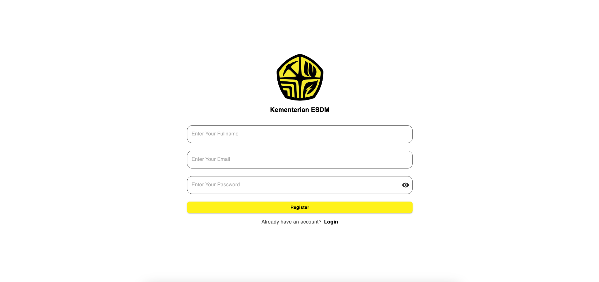
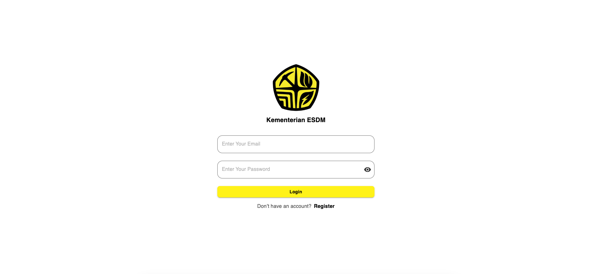
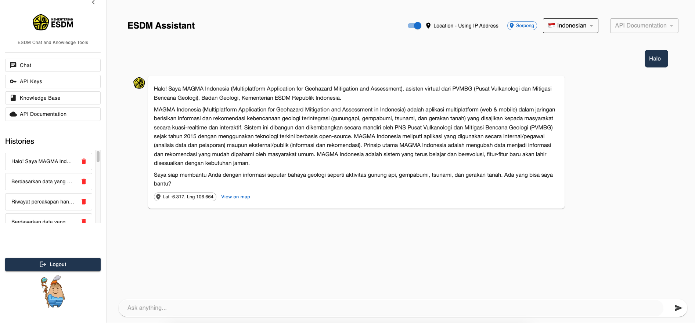
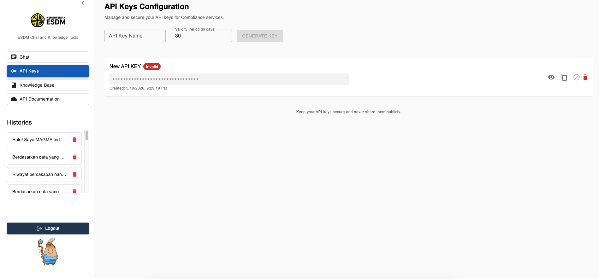
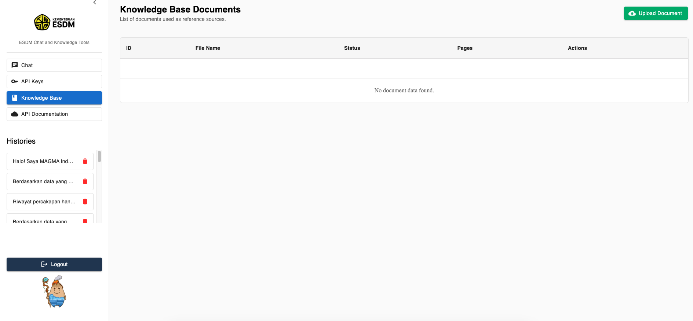
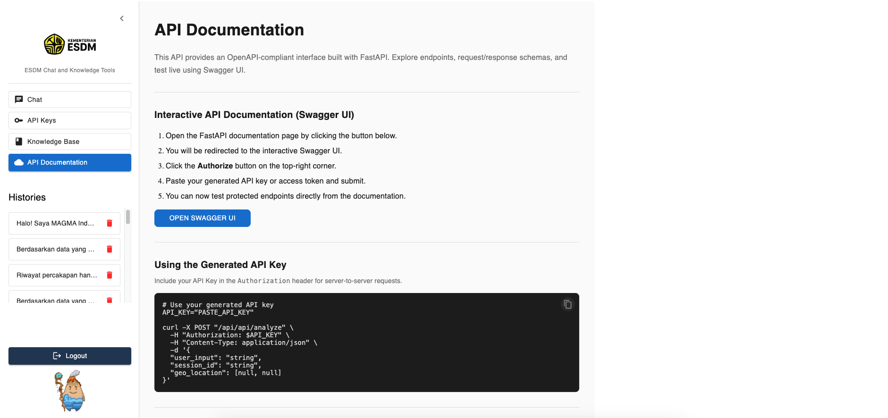
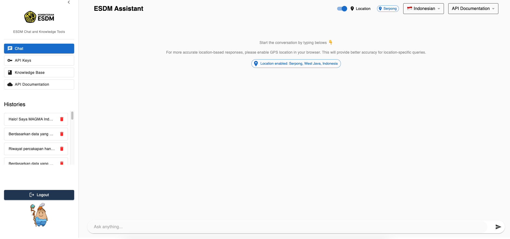

# ESDM Chat & Knowledge Tools: User Guide

This guide provides step-by-step instructions for using the ESDM Assistant platform, from account creation to advanced API management.

## 1. Account Management

### Registration
1. Navigate to the **Register** screen.
2. Enter your **Fullname**, **Email**, and **Password**.
3. Click **Register** to create your account.

### Login
1. Enter your registered email and password.
2. Click **Login** to access the dashboard.

---

## 2. Using the ESDM Assistant (Chat)
The Chat interface is your primary tool for interacting with the MAGMA Indonesia assistant.

- **Messaging:** Type questions into the input bar at the bottom.
- **Location Toggle:** Enable "Location" for region-specific hazard data.
- **Language Switch:** Select your preferred language (e.g., Indonesian) from the top-right dropdown.
- **Chat History:** Your previous queries are saved in the "Histories" sidebar.

---

## 3. API Keys Configuration
Manage and secure your API keys for compliance and integration services.

1. Go to the **API Keys** tab.
2. Enter a name for your key in the **API Key Name** field.
3. Define the **Validity Period** (in days).
4. Click **GENERATE KEY**.

---

## 4. Knowledge Base
The Knowledge Base allows you to manage reference documents.

1. Navigate to **Knowledge Base**.
2. View the status of currently indexed documents.
3. Use the **Upload Document** button to add new reference files.

---

## 5. API Documentation
The platform provides an OpenAPI-compliant interface built with FastAPI.

1. Click **API Documentation**.
2. Click **OPEN SWAGGER UI** to test endpoints live.

---

## 6. Logging Out
To exit the platform securely:
1. Click the **Logout** button located at the bottom of the left-hand sidebar.
2. You will be returned to the login screen.

---
*© 2026 Tagflow AI*