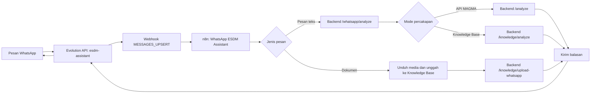

# Panduan Integrasi WhatsApp ESDM Assistant

Panduan ini khusus untuk kanal WhatsApp pada project `magma-ai-staging`. Gambaran sistem keseluruhan ada di [PROJECT_DOCUMENTATION.md](PROJECT_DOCUMENTATION.md). Konfigurasi n8n dan webhook Evolution saat ini disimpan di volume Docker, sehingga tidak cukup hanya membaca `docker-compose.yml` untuk memastikan alurnya aktif.

## 1. Cara kerja



Evolution API menangani koneksi dan pengiriman pesan WhatsApp. n8n menjalankan workflow, mengambil isi pesan, mengirim pertanyaan ke endpoint WhatsApp backend, lalu mengirim teks balasan melalui Evolution. Backend memilih sumber jawaban menurut mode percakapan. Worker dokumen memproses berkas yang diterima secara terpisah dan dapat mengirim pemberitahuan hasil setelah selesai. Instance yang digunakan bernama `esdm-assistant`.

Workflow aktif di n8n saat dokumentasi ini dibuat bernama **My workflow**. Node pentingnya adalah `WhatsApp ESDM Assistant`, `Edit Fields`, `Is Document`, `Ask WhatsApp Assistant`, node unggah dokumen, dan node pengiriman balasan. Dalam mode otomatis, pertanyaan kondisi kebencanaan memakai API MAGMA dan pertanyaan dokumen memakai Knowledge Base. Pengguna dapat memilih sumber secara eksplisit lewat perintah mode berikut.

## 2. Persiapan operator

1. Jalankan stack dari direktori project dengan `docker compose up -d`, kemudian pastikan `n8n`, `evolution-api`, `evolution-db`, `evolution-redis`, `backend`, `knowledge-worker`, dan `db` berstatus berjalan lewat `docker compose ps`.
2. Buka `http://localhost:8082/manager`. Saat login, gunakan URL server `http://localhost:8082` dan **global API key** yang dikonfigurasi untuk Evolution API. Jangan menyalin kunci tersebut ke dokumen, screenshot, atau chat publik.
3. Buka instance `esdm-assistant`. Jika belum terhubung, tekan **Get QR Code**, lalu di ponsel pilih **WhatsApp > Perangkat tertaut > Tautkan perangkat** dan pindai QR. QR adalah kredensial sementara; jangan membagikannya.
4. Buka `http://localhost:5679/` dan pastikan workflow **My workflow** aktif. Webhook produksi pada node `WhatsApp ESDM Assistant` harus memiliki path `whatsapp-incoming`.
5. Di pengaturan webhook instance Evolution, pastikan `enabled=true`, event `MESSAGES_UPSERT` aktif, `webhookByEvents=false`, dan URL tujuan `http://esdm-n8n:5678/webhook/whatsapp-incoming`. Alamat ini memakai nama container di jaringan Compose, bukan `localhost` dari dalam container.

Pengaturan webhook instance dapat diperiksa tanpa menampilkan API key:

```bash
evo_key=$(docker exec evolution-api printenv AUTHENTICATION_API_KEY)
curl -fsS -H "apikey: $evo_key" \
  http://localhost:8082/webhook/find/esdm-assistant \
  | jq '{enabled, url, events, webhookByEvents}'
```

Jika webhook belum ada, endpoint Evolution API v2.3.7 pada deployment ini menerima objek `webhook` di dalam body:

```bash
evo_key=$(docker exec evolution-api printenv AUTHENTICATION_API_KEY)
curl -fsS -X POST \
  http://localhost:8082/webhook/set/esdm-assistant \
  -H "apikey: $evo_key" \
  -H 'Content-Type: application/json' \
  --data '{"webhook":{"enabled":true,"url":"http://esdm-n8n:5678/webhook/whatsapp-incoming","webhookByEvents":false,"webhookBase64":false,"events":["MESSAGES_UPSERT"]}}'
```

## 3. Menggunakan chat WhatsApp

Kirim pesan ke nomor yang terhubung dengan instance `esdm-assistant` dari chat pribadi. Pertanyaan biasa tidak memerlukan login WhatsApp. Mode tetap berlaku untuk pesan berikutnya sampai diganti.

| Perintah | Fungsi |
| --- | --- |
| `/knowlage-base` | Paksa pertanyaan berikutnya mencari di dokumen Knowledge Base. Ejaan `/knowledge-base` juga diterima. |
| `/api-documentation` | Paksa pertanyaan berikutnya memakai layanan informasi MAGMA/API. |
| `/auto` | Kembali memilih sumber menurut isi pertanyaan dan konteks percakapan. |
| `/help` | Tampilkan bantuan singkat. |

Perintah juga boleh diikuti langsung oleh pertanyaan, misalnya `/api-documentation Apa informasi gempa terkini?`. Sesudah jawaban, asisten dapat menawarkan satu pertanyaan lanjutan yang relevan. Balas `ya` untuk menjalankannya, atau tulis pertanyaan lain; pertanyaan baru mengganti tawaran sebelumnya. Tawaran diperiksa terhadap pertanyaan dan tawaran yang sudah muncul agar tidak terus berulang. Jika tidak ada pertanyaan lanjutan yang dapat dipastikan sesuai sumber, tawaran tidak ditampilkan.

| Tujuan | Contoh pesan | Jalur yang diharapkan |
| --- | --- | --- |
| Status kebencanaan saat ini | `Berapa gunung yang statusnya Siaga sekarang?` | API MAGMA (`/analyze`) |
| Informasi gempa | `Apa informasi gempa terkini?` | API MAGMA (`/analyze`) |
| Isi dokumen | `Apa judul proyek di dokumen permohonan penelitian?` | Knowledge Base (`/knowledge/analyze`) |
| Ringkasan laporan | `Ringkas isi laporan minggu pertama` | Knowledge Base (`/knowledge/analyze`) |

Untuk pertanyaan dokumen, sebutkan judul, nama file, atau topik agar pencarian tidak mengambil chunk dari dokumen lain. Untuk pertanyaan kondisi saat ini, sebutkan kata seperti *sekarang*, *terkini*, atau *status* dan nama gunung bila ada. Jika jawaban tidak sesuai topik, tanyakan ulang dengan lebih spesifik dan periksa jalur eksekusi di n8n.

## 4. Login dan unggah dokumen melalui WhatsApp

Login WhatsApp dipakai untuk **unggah dokumen**. Lakukan hanya dalam chat pribadi; jangan masukkan password di grup.

1. Kirim `/login` dan ikuti permintaan email serta password. Sistem mencoba autentikasi akun yang terhubung; jika berhasil, sesi unggah aktif selama **30 menit**.
2. Kirim berkas `.pdf`, `.doc`, atau `.docx` berukuran maksimal **20 MB**. Sistem memberikan ID dokumen dan memasukkannya ke antrean.
3. Periksa balasan saat pemrosesan selesai. Di web, buka **Knowledge Base** untuk melihat status, chunk, audit kelengkapan teks, dan PDF bertanda.
4. Ketik `/status` untuk memeriksa sesi, `/logout` untuk keluar, atau `/batal` untuk membatalkan proses login yang belum selesai.

Maksimal lima percobaan password gagal akan membatalkan proses login. Tidak semua dokumen langsung `COMPLETED`: hasil awal dapat berstatus **Kurang lengkap** jika audit menemukan bagian penting yang belum masuk. Tinjau detail dokumen di web sebelum memutuskan menjalankan proses lanjutan atau menambah teks manual.

## 5. Memeriksa alur ketika balasan tidak muncul

Gunakan urutan berikut agar penyebabnya terlihat jelas.

1. **Koneksi WhatsApp:** di Evolution Manager, pastikan instance `esdm-assistant` berstatus terhubung. Container yang berjalan belum tentu berarti sesi WhatsApp sudah tersambung.
2. **Webhook:** periksa konfigurasi `MESSAGES_UPSERT` dengan perintah di bagian 2. Tanpa webhook ini, pesan masuk tidak sampai ke n8n.
3. **Workflow:** periksa apakah **My workflow** aktif dan apakah ada eksekusi baru di n8n setelah pesan dikirim. Jika tidak ada eksekusi, cek webhook dan koneksi Evolution.
4. **Node yang gagal:** bila eksekusi muncul tetapi tidak ada balasan, periksa node `Ask WhatsApp Assistant`, endpoint backend `/whatsapp/analyze`, dan node `sendText`. Pemilihan Knowledge Base atau API MAGMA dilakukan di backend.
5. **Backend dan worker:** jalankan `docker compose logs --tail=100 backend knowledge-worker n8n evolution-api`. Hindari membagikan output mentah bila memuat nomor telepon, isi pesan, atau credential.

Jika QR tidak muncul, periksa DNS dari dalam container Evolution dan koneksi ke WhatsApp. Pada sesi pengembangan sebelumnya, DNS Docker pernah gagal me-resolve `web.whatsapp.com` (`EAI_AGAIN`); penambahan resolver melalui override sementara membuat QR berhasil dibuat. Override di `/tmp` **tidak menjadi bagian Compose project** dan dapat hilang saat container dibuat ulang. Jika kejadian berulang, tetapkan resolver yang bekerja pada service `evolution-api` di konfigurasi Compose setelah diverifikasi pada jaringan yang dipakai, lalu buat ulang service tersebut.

## 6. Data dan pemulihan

Volume `evolution-instances` dan `evolution-postgres-data` menyimpan data instance; volume `n8n-data` menyimpan workflow. Menghapus volume akan menghilangkan data tersebut. Menjalankan `docker compose down` tanpa `-v` mempertahankannya.

Workflow dan pengaturan webhook dibuat di aplikasi yang sedang berjalan, bukan di berkas JSON pada repository ini. Untuk pindah mesin atau memulihkan lingkungan, lakukan backup volume serta ekspor workflow n8n dengan perlindungan terhadap API key di node. Setelah pemulihan, verifikasi kembali koneksi QR, URL webhook, status workflow, dan satu pesan uji untuk masing-masing jalur MAGMA dan Knowledge Base.
