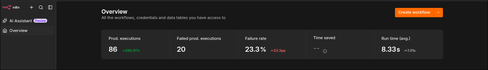
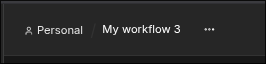
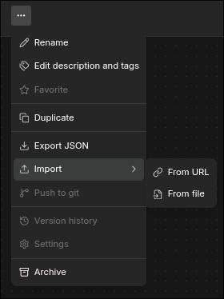
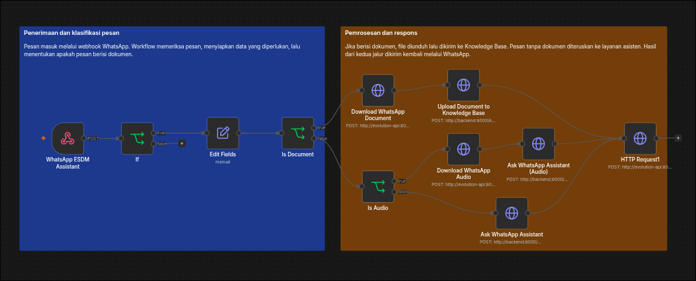
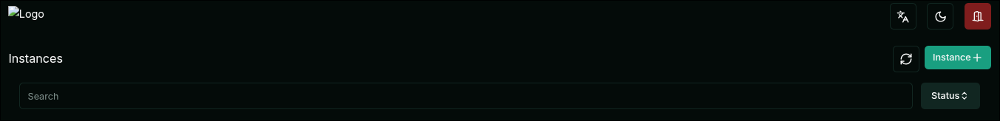
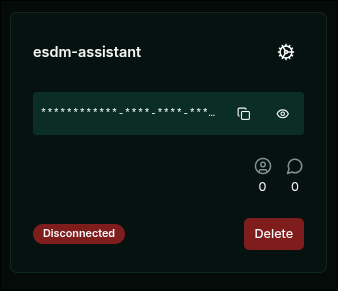
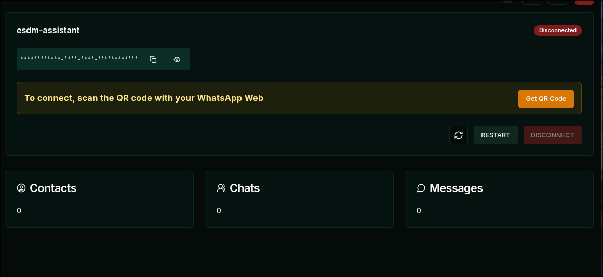

# Panduan Pemasangan MAGMA AI dan NARA

Jalankan MAGMA AI di komputer lokal dengan Docker Compose, lalu ikuti [panduan web](USER_GUIDE.md) atau [panduan WhatsApp](WHATSAPP_GUIDE.md) untuk mencoba fiturnya. [README](../README.md) menjelaskan cara kerja sistem.

## Daftar isi

- [Prasyarat](#prasyarat)
- [Clone repositori](#clone-repositori)
- [Konfigurasi lingkungan](#konfigurasi-lingkungan)
- [Penyimpanan dan model lokal](#penyimpanan-dan-model-lokal)
- [Menjalankan layanan](#menjalankan-layanan)
- [Alamat layanan](#alamat-layanan)
- [Menyiapkan n8n](#menyiapkan-n8n)
- [Menghubungkan Evolution API dan memindai QR](#menghubungkan-evolution-api-dan-memindai-qr)
- [Menghubungkan webhook dan menguji WhatsApp](#menghubungkan-webhook-dan-menguji-whatsapp)
- [Pemeriksaan awal](#pemeriksaan-awal)
- [Pemecahan masalah](#pemecahan-masalah)
- [Menghentikan layanan](#menghentikan-layanan)
- [Catatan keamanan](#catatan-keamanan)

## Prasyarat

- Git, Docker Engine, dan plugin Docker Compose (cek dengan `docker compose version`).
- Ruang disk untuk database, dokumen, dan model GGUF, serta RAM/CPU yang cukup untuk model lokal dan ekstraksi dokumen.
- Koneksi internet untuk API MAGMA, WhatsApp, Groq, dan OpenRouter bila dipakai.
- Akses ke direktori host yang dipakai sebagai bind mount di `docker-compose.yml`.

Jalankan perintah dari root repositori. Pastikan port host `80`, `3000`, `5432`, `5679`, `8081`, dan `8082` belum dipakai. Alamat `localhost` dalam panduan ini menganggap browser dan Docker berjalan di mesin yang sama.

Sertakan `-p magma-ai-staging` pada setiap perintah Compose. Worker memakai image `magma-ai-staging-backend`, sehingga nama proyek Compose perlu tetap sama meskipun nama folder hasil clone berbeda. Jalankan satu stack dengan nama proyek ini pada tiap host.

## Clone repositori

```bash
git clone https://github.com/usernamenuh/MAGMA-AI.git magma-ai-staging
cd magma-ai-staging
```

Jika repositori masih privat, minta akses untuk akun GitHub yang akan dipakai. Simpan token di credential manager Git, jangan di URL clone. Jika proyek sudah ada di komputer, masuk ke root repositori tanpa mengkloning ulang.

## Konfigurasi lingkungan

Salin template konfigurasi (belum berisi kredensial asli):

```bash
cp ms-esdm/.env.example ms-esdm/.env
cp fe-esdm/.env.example fe-esdm/.env
cp openai_local/env.example openai_local/.env
```

Isi setiap `.env` sesuai layanan yang akan dipakai. Untuk backend, periksa `APP_ID`, `SECRET_KEY`, URL database, rahasia JWT, dan kunci penyedia model. Untuk WhatsApp, periksa `EVOLUTION_API_KEY` dan `EVOLUTION_INSTANCE`.

### Konfigurasi API key Groq dan OpenRouter

Simpan API key penyedia model di `ms-esdm/.env`. Setiap layanan menggunakan variabel yang berbeda:

| Layanan | Membuat API key | Panduan resmi | Variabel | Fungsi |
| --- | --- | --- | --- | --- |
| Groq | [GroqCloud API Keys](https://console.groq.com/keys) | [Quickstart Groq](https://console.groq.com/docs/quickstart) | `GROQ_API_KEY` | Model chat Groq dan transkripsi voice note dengan Whisper. |
| OpenRouter | [OpenRouter API Keys](https://openrouter.ai/settings/keys) | [Quickstart OpenRouter](https://openrouter.ai/docs/quickstart) | `OPENROUTER_API_KEY` | Model chat melalui OpenRouter. |

1. Masuk ke konsol penyedia yang ingin digunakan dan buat API key.
2. Buka `ms-esdm/.env`, lalu isi variabel yang sesuai dengan API key dari konsol:

   ```dotenv
   GROQ_API_KEY=<API_KEY_GROQ>
   OPENROUTER_API_KEY=<API_KEY_OPENROUTER>
   ```

   Ganti teks dalam tanda `< >` dengan nilai sebenarnya. Kosongkan variabel layanan yang tidak digunakan, misalnya `OPENROUTER_API_KEY=`. Jangan menambahkan awalan `Bearer `.

3. Jika backend sudah berjalan, jalankan perintah berikut dari root repositori agar container membaca konfigurasi baru:

   ```bash
   docker compose -p magma-ai-staging up -d --force-recreate backend
   ```

Kedua API key boleh kosong jika hanya menggunakan model lokal. Transkripsi voice note WhatsApp memerlukan `GROQ_API_KEY`, meskipun jawaban memakai model lain. Untuk menguji konfigurasi, pilih model Groq atau OpenRouter di chat web lalu kirim pertanyaan. Daftar model dapat tampil meskipun API key belum valid, jadi pastikan pertanyaan mendapat jawaban. Simpan API key di luar Git, screenshot, dan pesan publik.

Samakan `EVOLUTION_API_KEY` di backend dengan `AUTHENTICATION_API_KEY` pada service `evolution-api` di Compose. Jika mengganti kunci contoh, perbarui juga nilainya di `knowledge-worker`. Frontend memakai `VITE_API_URL=/api` lewat Nginx. Build ulang frontend setelah mengubah variabel `VITE_*` karena Vite memasukkan nilainya saat build.

Untuk voice note WhatsApp, Groq Whisper mentranskripsi pesan masuk, Edge TTS membuat balasan suara, dan Evolution API mengirimkannya. Alur ini memerlukan koneksi internet. Workflow n8n harus mengirim audio ke backend melalui `audio_base64` dan, jika ada, `audio_mimetype`. Impor file workflow dari repositori pada langkah n8n di bawah.

Compose masih memakai kredensial contoh untuk database dan Evolution API, jadi ganti dulu sebelum stack diakses orang lain. Port `80`, `3000`, dan `5432` terbuka di host, sehingga periksa firewall sebelum dipakai di jaringan bersama.

## Penyimpanan dan model lokal

Compose memasang `./data/blobs` untuk berkas dokumen dan `./data/models` untuk model. Keduanya ada di dalam folder proyek dan bisa dibuat dari root repositori tanpa `sudo`:

```bash
mkdir -p data/blobs data/models
```

Git tidak menyertakan berkas model GGUF. Unduh Qwen ke `data/models` dan periksa checksum sesuai [panduan model lokal](../openai_local/LOCAL_MODEL.md). Service `openai-local` memerlukan berkas itu untuk melayani permintaan. Aturan `.gitignore` mengecualikan folder `data/` agar dokumen dan model tidak masuk commit.

**Kalau sebelumnya memakai `/mnt/data/magma-ai`:** data lama tidak pindah dengan sendirinya. Sebelum menjalankan Compose dengan konfigurasi baru, salin berkas dokumen ke `data/blobs` dan model ke `data/models`, atau ubah mount agar menunjuk ke lokasi yang masih dipakai. Hapus lokasi lama hanya setelah isi dan hak aksesnya dipastikan aman.

Volume PostgreSQL utama bersifat eksternal dengan nama `magma-ai_esdm-data`. Untuk instalasi **baru tanpa data lama**, buat volume ini:

```bash
docker volume create magma-ai_esdm-data
```

Kalau memindahkan instalasi lama, pulihkan dulu volume lamanya. Volume baru dengan nama yang sama tetap kosong dan tidak berisi dokumen atau akun sebelumnya.

## Menjalankan layanan

```bash
docker compose -p magma-ai-staging up -d --build
docker compose -p magma-ai-staging ps
```

Build pertama dapat memakan waktu beberapa menit. Tunggu hingga backend berstatus sehat; jika statusnya tidak berubah, periksa log. Untuk WhatsApp, lanjutkan dengan menautkan sesi serta mengatur workflow dan webhook di bagian berikutnya.

## Alamat layanan

| Alamat lokal | Fungsi |
| --- | --- |
| `http://localhost/` | Aplikasi web lewat Nginx. |
| `http://localhost/api/docs` | Dokumentasi API backend. |
| `http://localhost:3000/` | Frontend langsung. |
| `http://localhost:5679/` | n8n, hanya dari host. |
| `http://localhost:8082/manager` | Evolution Manager, hanya dari host. |
| `http://localhost:8081/` | Adminer, hanya dari host. |

Port n8n, Evolution Manager, dan Adminer diikat ke `127.0.0.1`, sehingga dari komputer lain alamat `localhost` tidak akan mengarah ke host Docker. Untuk akses jarak jauh, pakai tunnel SSH atau proxy yang sudah diberi autentikasi. n8n memakai port `5679` di host dan port `5678` di jaringan Compose. Karena itu, `http://localhost:5678/` memang tidak terbuka di browser host.

## Menyiapkan n8n

1. Buka `http://localhost:5679/`. Pada instalasi baru, buat akun pemilik n8n. Kalau volume `n8n-data` dipulihkan dari cadangan, masuk dengan akun yang sudah ada.
2. Pada instalasi baru, buka tab **Overview** lalu klik **Create workflow** di kanan atas. Kalau **My workflow** sudah ada dari volume lama, cukup buka dan periksa konfigurasinya tanpa mengimpor ulang.

   

3. Di editor workflow yang baru dibuat, klik **titik tiga (⋯)** di samping judul workflow.

   

4. Pilih **Import → From file**, lalu pilih [berkas workflow WhatsApp](n8n/whatsapp-workflow.json) dari folder proyek. Menu **Export JSON** fungsinya kebalikan, yaitu untuk mengunduh workflow dari n8n.

   

5. Buka tiga node yang memanggil backend: `Ask WhatsApp Assistant`, `Ask WhatsApp Assistant (Audio)`, dan `Upload Document to Knowledge Base`. Di setiap node, isi header `Authorization` dengan `Bearer ` diikuti nilai `MS_KEY` dari `ms-esdm/.env`, sampai tidak ada lagi placeholder `REPLACE_WITH_MS_KEY`.
6. Buka tiga node yang memanggil Evolution: `HTTP Request1`, `Download WhatsApp Document`, dan `Download WhatsApp Audio`. Isi header `apikey` dengan nilai `AUTHENTICATION_API_KEY` dari service `evolution-api` di Compose (nilainya sama dengan `EVOLUTION_API_KEY` di backend), sampai tidak ada lagi placeholder `REPLACE_WITH_EVOLUTION_API_KEY`. Kunci asli cukup disimpan di n8n, tidak perlu masuk Git atau screenshot.
7. Periksa URL pada node HTTP Request. Template memakai `http://backend:8000` dan `http://evolution-api:8080` dengan nama instance `esdm-assistant`. Alamat ini hanya berlaku di dalam jaringan Compose, bukan dari browser host.
8. Periksa node Webhook **WhatsApp ESDM Assistant**. Metodenya `POST` dengan path produksi `whatsapp-incoming`. Pakai URL **Production** saat menghubungkannya ke Evolution. Pastikan juga node untuk teks, audio, dan dokumen tetap tersambung seperti contoh berikut.

   

9. Simpan dan aktifkan (*publish*) workflow. Setelah mengirim pesan uji, buka tab **Executions** dan cari eksekusi baru. URL *test* hanya bekerja saat editor n8n menunggu event; gunakan URL *production* untuk pesan biasa. Impor JSON tidak membuat akun, kredensial, instance Evolution, atau sesi WhatsApp.

## Menghubungkan Evolution API dan memindai QR

Pemilik nomor WhatsApp perlu memindai QR dari instance miliknya. Jangan memakai sesi milik pengembang sebelumnya.

1. Pastikan service `evolution-api`, `evolution-db`, dan `evolution-redis` berjalan dengan `docker compose -p magma-ai-staging ps`, lalu buka `http://localhost:8082/manager` di browser host Docker.
2. Di halaman login Evolution Manager, isi **Server URL** dengan `http://localhost:8082` dan **API Key Global** dengan nilai `AUTHENTICATION_API_KEY` pada service `evolution-api` di `docker-compose.yml`, lalu klik **Login**. Kunci ini untuk masuk ke Manager, berbeda dengan token instance di langkah berikutnya. Alamat `http://evolution-api:8080` hanya berlaku antarcontainer, jadi tidak bisa dibuka dari browser host.
3. Di halaman **Instances**, cari `esdm-assistant`. Kalau belum ada, klik **Instance +**. Kalau sudah ada, pakai instance itu dan lompat ke langkah 6.

   

4. Di formulir **New instance**, isi **Name** dengan `esdm-assistant` dan pilih **Channel: Baileys**. Nama ini harus sama dengan `EVOLUTION_INSTANCE` di backend dan URL di workflow n8n.
5. Isi **Token** dengan nilai unik yang Anda simpan sendiri. Kosongkan **Number** kalau akan menautkan lewat QR, lalu klik **Save** hingga kartu `esdm-assistant` muncul di daftar. Screenshot formulir ini sengaja tidak disertakan karena memuat token asli.
6. Klik kartu `esdm-assistant`. Status **Disconnected** di awal itu wajar karena QR belum dipindai. Buka pengaturan di pojok kanan atas kartu.

   

7. Di halaman detail instance, klik **Get QR Code** dan tunggu dialog QR muncul. Kalau kodenya kedaluwarsa, tutup dialog lalu minta QR baru.

   

8. Di ponsel pemilik nomor, buka **WhatsApp → Perangkat tertaut → Tautkan perangkat**, lalu pindai QR yang sedang tampil di Evolution Manager. Jangan bagikan QR karena orang lain dapat memakainya untuk menautkan perangkat.
9. Kembali ke Manager dan tunggu sampai status berubah menjadi **Connected**. Kalau belum berubah, muat ulang halaman dan cek daftar **Perangkat tertaut** di ponsel. Status Connected baru berarti WhatsApp tersambung ke Evolution; pesan belum tentu sampai ke n8n sebelum webhook diatur di bagian berikutnya.

QR dan token instance adalah kredensial sesi, karena itu screenshot QR asli dan formulir token tidak dimasukkan ke repositori. Kalau QR tidak muncul, periksa `docker compose -p magma-ai-staging logs --tail=100 evolution-api` serta DNS dan koneksi container ke WhatsApp. Masalah ini pernah terjadi ketika container gagal me-resolve `web.whatsapp.com`, dan restart saja tidak menyelesaikannya. Biarkan volume Evolution tetap utuh selama memperbaiki, karena menghapusnya akan menghilangkan data sesi.

## Menghubungkan webhook dan menguji WhatsApp

QR menghubungkan instance `esdm-assistant` ke WhatsApp, tetapi belum mengirim pesan ke n8n. Pasang webhook setelah workflow n8n aktif:

1. Di n8n, buka node **WhatsApp ESDM Assistant**. Pilih tab **Production URL** dan pastikan metode `POST` serta path `whatsapp-incoming`. URL yang tampil di browser memakai `localhost:5679`; alamat itu berlaku untuk host, bukan untuk Evolution di dalam Compose.
2. Di Evolution Manager, buka instance `esdm-assistant`, lalu masuk ke halaman **Webhook**. Aktifkan **Enabled** dan isi **URL** dengan `http://esdm-n8n:5678/webhook/whatsapp-incoming`.
3. Biarkan **Webhook by Events** dan **Webhook Base64** mati. Pada daftar event di bawahnya, pilih `MESSAGES_UPSERT`, lalu simpan. Jika **Webhook by Events** aktif, Evolution menambahkan nama event ke ujung URL dan path n8n tidak cocok.
4. Periksa hasilnya dengan perintah berikut dari host Docker. Perintah ini memerlukan `curl` dan `jq`:

   ```bash
   evo_key=$(docker exec evolution-api printenv AUTHENTICATION_API_KEY)
   curl -fsS -H "apikey: $evo_key" \
     http://localhost:8082/webhook/find/esdm-assistant \
     | jq 'if . == null then {configured: false} else {enabled, url, events, webhookByEvents} end'
   ```

   Hasil yang benar memuat `enabled: true`, URL internal di atas, `MESSAGES_UPSERT`, dan `webhookByEvents: false`. Jika hasilnya `configured: false`, webhook belum tersimpan. Kembali ke halaman **Webhook** dan simpan pengaturan, atau gunakan [perintah API pada panduan WhatsApp](WHATSAPP_GUIDE.md#2-persiapan-operator). Jangan tempel nilai `evo_key` atau output mentah yang memuat data pribadi ke issue publik.

Pengaturan webhook tidak terbentuk otomatis saat Compose dijalankan. Periksa lagi setelah membuat instance baru atau memulihkan volume. URL produksi yang tampil di n8n boleh berbeda pada bagian host dan port; path `/webhook/whatsapp-incoming` harus sama.

Untuk menguji, kirim `/help` dari nomor WhatsApp lain ke nomor yang sudah ditautkan. Pastikan muncul eksekusi baru di n8n dan balasan teks masuk. Setelah itu, coba satu pertanyaan API MAGMA dan satu pertanyaan Knowledge Base. Untuk voice note, pastikan `GROQ_API_KEY` sudah diisi dan node n8n meneruskan audio. Kalau pesan sampai di n8n tetapi tidak dibalas, cari node yang gagal di **Executions** dan periksa log backend.

## Pemeriksaan awal

```bash
docker compose -p magma-ai-staging ps
docker compose -p magma-ai-staging logs --tail=100 backend knowledge-worker openai-local
docker compose -p magma-ai-staging logs --tail=100 n8n evolution-api
```

## Pemecahan masalah

Mulai dari pesan uji baru seperti `/help`. Pesan yang dikirim sebelum webhook terpasang tidak diproses ulang otomatis. Buka **Executions** pada workflow n8n setelah mengirim pesan, lalu cocokkan gejalanya dengan tabel berikut.

| Gejala | Cara mengatasi |
| --- | --- |
| Web tidak terbuka | Jalankan `docker compose -p magma-ai-staging ps`. Jika `nginx`, `frontend`, atau `backend` berhenti, baca log service tersebut dan jalankan `docker compose -p magma-ai-staging up -d --build` setelah memperbaiki error. Jika Compose melaporkan port `80` sudah dipakai, hentikan layanan lain yang memakai port itu atau ubah port host pada service `nginx` di Compose. |
| n8n terbuka, tetapi workflow kosong | Buat workflow baru, lalu impor `docs/n8n/whatsapp-workflow.json` melalui **⋯ → Import → From file**. Isi kunci pada node HTTP Request sesuai langkah [Menyiapkan n8n](#menyiapkan-n8n), simpan, dan aktifkan workflow. |
| Evolution Manager menolak login | Isi **Server URL** dengan `http://localhost:8082`. Isi **API Key Global** dari `AUTHENTICATION_API_KEY` pada service `evolution-api` di Compose, bukan token instance. Jika masih gagal, jalankan `docker compose -p magma-ai-staging logs --tail=100 evolution-api` dan perbaiki error yang muncul. |
| WhatsApp menunjukkan pesan terkirim, tetapi tidak ada eksekusi baru di n8n | Pastikan instance `esdm-assistant` berstatus **Connected**. Jalankan [pemeriksaan webhook](#menghubungkan-webhook-dan-menguji-whatsapp). Jika hasilnya `configured: false`, aktifkan **Enabled**, isi URL internal n8n, centang `MESSAGES_UPSERT`, lalu simpan. Pastikan workflow n8n aktif; kirim pesan **baru** setelah menyimpan. |
| n8n menampilkan eksekusi gagal pada node backend | Buka node yang gagal di **Executions**. Untuk error `401` atau `403`, isi header `Authorization` dengan `Bearer ` diikuti nilai `MS_KEY` dari `ms-esdm/.env`; jangan biarkan placeholder template. Untuk error koneksi, gunakan URL container `http://backend:8000` dan pastikan backend sehat lewat `docker compose -p magma-ai-staging ps backend`. |
| Eksekusi n8n selesai, tetapi balasan tidak muncul di WhatsApp | Buka node pengiriman balasan. Gunakan instance `esdm-assistant` dan isi header `apikey` dengan `AUTHENTICATION_API_KEY` dari Compose. Pastikan instance **Connected**, lalu lihat `docker compose -p magma-ai-staging logs --tail=100 evolution-api` untuk error pengiriman. |
| Voice note masuk tidak ditranskripsi | Isi `GROQ_API_KEY` di `ms-esdm/.env`, lalu buat ulang backend dengan `docker compose -p magma-ai-staging up -d --force-recreate backend`. Pastikan node audio n8n meneruskan `audio_base64` dan `audio_mimetype`. Jika masih gagal, buka node yang gagal di **Executions** dan periksa log backend. |
| Jawaban teks masuk, tetapi tidak ada balasan suara | Kirim `/voice`, lalu ajukan pertanyaan baru. Jika mode sudah aktif, periksa log backend untuk error Edge TTS atau pengiriman audio melalui Evolution. Voice note masuk tidak mengaktifkan mode balasan suara dengan sendirinya. |
| `localhost:5679` terbuka, tetapi `localhost:5678` gagal | Tidak perlu memperbaiki port `5678` di host. Buka n8n melalui `http://localhost:5679/`; isi webhook Evolution dengan `http://esdm-n8n:5678/webhook/whatsapp-incoming`. |
| QR Evolution tidak muncul | Jalankan `docker compose -p magma-ai-staging logs --tail=100 evolution-api`, lalu uji DNS dengan `docker exec evolution-api getent hosts web.whatsapp.com`. Jika tidak ada alamat dan log memuat `EAI_AGAIN`, periksa koneksi serta pengaturan DNS host/Docker sebelum meminta QR baru. Jangan hapus volume Evolution karena volume itu menyimpan sesi. |
| Dokumen tertahan di antrean atau Knowledge Base terus memuat | Jalankan `docker compose -p magma-ai-staging ps db backend knowledge-worker`, lalu baca `docker compose -p magma-ai-staging logs --tail=100 backend knowledge-worker`. Jika worker berhenti, jalankan `docker compose -p magma-ai-staging up -d knowledge-worker`. Jika database bermasalah, pulihkan koneksinya lebih dulu; jangan hapus volume untuk mengulang pemrosesan. |
| Model lokal gagal menghasilkan jawaban | Pastikan GGUF ada di `data/models` dan `MODEL_PATH` di `openai_local/.env` cocok dengan nama berkas. Baca `docker compose -p magma-ai-staging logs --tail=100 openai-local`; setelah memperbaiki path, jalankan `docker compose -p magma-ai-staging up -d --force-recreate openai-local`. |

Jika masalah masih terjadi, ikuti urutan **Evolution → n8n → backend → Evolution**. Catat waktu pesan uji dan node terakhir yang berhasil, lalu periksa log pada layanan setelah titik tersebut. [Panduan WhatsApp](WHATSAPP_GUIDE.md#5-memeriksa-alur-ketika-balasan-tidak-muncul) memuat pemeriksaan khusus kanal WhatsApp.

## Menghentikan layanan

```bash
docker compose -p magma-ai-staging down
```

Perintah di atas tetap menyimpan volume. Opsi `-v` (`docker compose down -v`) akan menghapus database, workflow n8n, dan sesi WhatsApp, jadi hanya pakai kalau memang ingin mulai dari nol. Cadangkan volume dan direktori dokumen sebelum migrasi.

## Catatan keamanan

Konfigurasi Compose ini dimaksudkan sebagai titik awal di lingkungan lokal dan belum siap untuk deployment publik. Ganti kredensial contoh, batasi port yang terbuka, serta jaga berkas `.env`, volume, dan QR WhatsApp.
