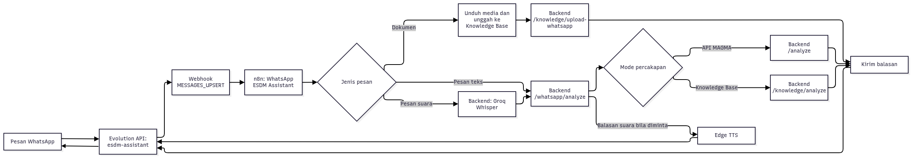

# Panduan WhatsApp MAGMA AI dan NARA

Gunakan NARA di WhatsApp untuk bertanya melalui teks atau voice note dan mengunggah dokumen setelah login. Siapkan kanalnya melalui [panduan pemasangan](INSTALLATION_GUIDE.md). Repositori menyertakan template workflow; setiap instalasi baru tetap memerlukan akun n8n, kunci, webhook, dan sesi WhatsApp sendiri.

## 1. Cara kerja



Evolution API menghubungkan nomor WhatsApp dan mengirim pesan. n8n meneruskan isi pesan ke backend, lalu backend memilih sumber jawaban sesuai mode percakapan. Untuk voice note masuk, Groq Whisper mentranskripsi audio sebelum backend memproses pertanyaannya. Saat mode `/voice` aktif, Edge TTS membuat balasan audio yang dikirim Evolution API. Voice note masuk tidak mengaktifkan mode balasan suara dengan sendirinya; NARA tetap mengirim jawaban teks. Worker memproses dokumen secara terpisah. Nama instance pada panduan ini adalah `esdm-assistant`.

Untuk pesan suara, workflow n8n mengirim audio ke endpoint `/whatsapp/analyze` melalui `audio_base64` dan, jika tersedia, `audio_mimetype`. [Template workflow](n8n/whatsapp-workflow.json) memakai placeholder sebagai pengganti kunci. Setelah impor, isi kunci pada node HTTP Request dan uji dengan instance yang sudah terhubung.

Template bernama **My workflow**. Di dalamnya ada node `WhatsApp ESDM Assistant`, `Edit Fields`, `Is Document`, `Ask WhatsApp Assistant`, unggah dokumen, dan pengiriman balasan. Mode otomatis memilih API MAGMA untuk pertanyaan kondisi kebencanaan dan Knowledge Base untuk pertanyaan dokumen. Pengguna juga dapat memilih sumber melalui perintah di bawah.

## 2. Persiapan operator

1. Jalankan stack dari root repositori menurut [panduan pemasangan](INSTALLATION_GUIDE.md), lalu pastikan `n8n`, `evolution-api`, `evolution-db`, `evolution-redis`, `backend`, `knowledge-worker`, dan `db` berstatus berjalan lewat `docker compose -p magma-ai-staging ps`.
2. Buka `http://localhost:8082/manager`. Saat login, gunakan URL server `http://localhost:8082` dan **global API key** yang dikonfigurasi untuk Evolution API. Jangan menyalin kunci tersebut ke dokumen, screenshot, atau chat publik.
3. Buka instance `esdm-assistant`. Jika belum terhubung, tekan **Get QR Code**, lalu di ponsel pilih **WhatsApp > Perangkat tertaut > Tautkan perangkat** dan pindai QR. QR adalah kredensial sementara; jangan membagikannya.
4. Buka `http://localhost:5679/` dan pastikan workflow **My workflow** aktif. Webhook produksi pada node `WhatsApp ESDM Assistant` harus memiliki path `whatsapp-incoming`.
5. Di pengaturan webhook instance Evolution, pastikan `enabled=true`, event `MESSAGES_UPSERT` aktif, `webhookByEvents=false`, dan URL tujuan `http://esdm-n8n:5678/webhook/whatsapp-incoming`. Alamat ini memakai nama container di jaringan Compose, bukan `localhost` dari dalam container.

Pengaturan webhook instance dapat diperiksa tanpa menampilkan API key:

```bash
evo_key=$(docker exec evolution-api printenv AUTHENTICATION_API_KEY)
curl -fsS -H "apikey: $evo_key" \
  http://localhost:8082/webhook/find/esdm-assistant \
  | jq '{enabled, url, events, webhookByEvents}'
```

Jika webhook belum ada, endpoint Evolution API v2.3.7 pada deployment ini menerima objek `webhook` di dalam body:

```bash
evo_key=$(docker exec evolution-api printenv AUTHENTICATION_API_KEY)
curl -fsS -X POST \
  http://localhost:8082/webhook/set/esdm-assistant \
  -H "apikey: $evo_key" \
  -H 'Content-Type: application/json' \
  --data '{"webhook":{"enabled":true,"url":"http://esdm-n8n:5678/webhook/whatsapp-incoming","webhookByEvents":false,"webhookBase64":false,"events":["MESSAGES_UPSERT"]}}'
```

## 3. Menggunakan chat WhatsApp

Kirim pesan ke nomor yang terhubung dengan instance `esdm-assistant` dari chat pribadi. Pertanyaan biasa tidak memerlukan login WhatsApp. Mode tetap berlaku untuk pesan berikutnya sampai diganti.

| Perintah | Fungsi | Kapan digunakan |
| --- | --- | --- |
| `/help` | Menampilkan bantuan singkat. | Saat baru memakai NARA. |
| `/api-documentation` | Memilih API MAGMA sebagai sumber jawaban. | Untuk status gunung api atau informasi kebencanaan MAGMA. |
| `/knowlage-base` atau `/knowledge-base` | Memilih dokumen Knowledge Base sebagai sumber jawaban. | Untuk bertanya tentang dokumen yang sudah diproses. |
| `/auto` | Mengembalikan pemilihan sumber otomatis. | Saat ingin keluar dari mode sumber yang dipilih manual. |
| `/voice` (alias `/suara`, `/voice-mode`) | Mengaktifkan balasan voice note untuk jawaban berikutnya. | Saat ingin mendengar jawaban selain membaca teks. |
| `/voice off` atau `/text` (alias `/teks`) | Menonaktifkan mode suara. | Saat ingin menerima jawaban teks saja. |
| `/login` | Memulai login untuk unggah dokumen dalam chat pribadi. | Sebelum mengirim berkas PDF/Word. |
| `/status` | Memeriksa sesi login WhatsApp. | Saat ingin mengetahui apakah sesi unggah masih aktif. |
| `/logout` | Mengakhiri sesi login. | Setelah selesai mengunggah. |
| `/batal` | Membatalkan proses login yang belum selesai. | Bila ingin mengulang login. |

Perintah mode dapat diikuti pertanyaan pada pesan yang sama, misalnya `/api-documentation Apa informasi gempa terkini?` atau `/voice Bagaimana status Merapi?`. `/voice on` mengaktifkan balasan suara; `/voice off` dan `/voice mati` menonaktifkannya.

Setelah menjawab, NARA dapat menawarkan satu pertanyaan lanjutan. Balas `ya` untuk menanyakannya, atau kirim pertanyaan baru untuk mengganti tawaran tersebut. NARA memeriksa kesesuaian tawaran dengan pertanyaan dan riwayat agar tidak mengulanginya. Jika tidak menemukan tawaran yang sesuai sumber, NARA tidak menampilkannya.

| Tujuan | Contoh pesan | Jalur yang diharapkan |
| --- | --- | --- |
| Status kebencanaan saat ini | `Berapa gunung yang statusnya Siaga sekarang?` | API MAGMA (`/analyze`) |
| Informasi gempa | `Apa informasi gempa terkini?` | API MAGMA (`/analyze`) |
| Isi dokumen | `Apa judul proyek di dokumen permohonan penelitian?` | Knowledge Base (`/knowledge/analyze`) |
| Ringkasan laporan | `Ringkas isi laporan minggu pertama` | Knowledge Base (`/knowledge/analyze`) |

Untuk pertanyaan dokumen, sebutkan judul, nama file, atau topik agar pencarian tidak mengambil chunk dari dokumen lain. Untuk pertanyaan kondisi saat ini, sebutkan kata seperti *sekarang*, *terkini*, atau *status* dan nama gunung bila ada. Jika jawaban tidak sesuai topik, tanyakan ulang dengan lebih spesifik dan periksa jalur eksekusi di n8n.

### Bertanya dengan pesan suara

Kirim voice note berisi pertanyaan yang jelas. Backend mentranskripsi audio dari n8n dan mengirim jawaban teks. Jika mode `/voice` aktif, NARA juga mengirim voice note. Dalam mode `/voice off` atau `/text`, NARA hanya mengirim teks meskipun pertanyaannya berupa voice note. Ketik `/voice` untuk mengaktifkan kembali balasan suara; perintah itu boleh diikuti pertanyaan pada pesan yang sama.

Transkripsi memerlukan `GROQ_API_KEY` pada backend dan koneksi ke Groq. Edge TTS juga memerlukan jaringan; Evolution API memerlukan instance WhatsApp yang terhubung untuk mengirim audio. Backend mengerjakan balasan suara di background, sehingga balasan teks masih dapat muncul saat TTS atau Evolution gagal. Untuk jawaban panjang, NARA dapat membacakan versi ringkas. Baca pesan teks untuk rincian lengkap, dan periksa transkripsi yang meragukan sebelum memakai jawabannya untuk keputusan keselamatan.

## 4. Login dan unggah dokumen melalui WhatsApp

Login WhatsApp dipakai untuk **unggah dokumen**. Lakukan hanya dalam chat pribadi; jangan masukkan password di grup.

1. Kirim `/login` dan ikuti permintaan email serta password. Sistem mencoba autentikasi akun yang terhubung; jika berhasil, sesi unggah aktif selama **30 menit**.
2. Kirim berkas `.pdf`, `.doc`, atau `.docx` berukuran maksimal **20 MB**. Sistem memberikan ID dokumen dan memasukkannya ke antrean.
3. Periksa balasan saat pemrosesan selesai. Di web, buka **Knowledge Base** untuk melihat status, chunk, audit kelengkapan teks, dan PDF bertanda.
4. Ketik `/status` untuk memeriksa sesi, `/logout` untuk keluar, atau `/batal` untuk membatalkan proses login yang belum selesai.

Maksimal lima percobaan password gagal akan membatalkan proses login. Tidak semua dokumen langsung `COMPLETED`: hasil awal dapat berstatus **Kurang lengkap** jika audit menemukan bagian penting yang belum masuk. Tinjau detail dokumen di web sebelum memutuskan menjalankan proses lanjutan atau menambah teks manual.

## 5. Memeriksa alur ketika balasan tidak muncul

Periksa alur dari Evolution sampai backend dengan urutan berikut.

1. **Koneksi WhatsApp:** di Evolution Manager, pastikan instance `esdm-assistant` berstatus terhubung. Container yang berjalan belum tentu berarti sesi WhatsApp sudah tersambung.
2. **Webhook:** periksa konfigurasi `MESSAGES_UPSERT` dengan perintah di bagian 2. Tanpa webhook ini, pesan masuk tidak sampai ke n8n.
3. **Workflow:** periksa apakah **My workflow** aktif dan apakah ada eksekusi baru di n8n setelah pesan dikirim. Jika tidak ada eksekusi, cek webhook dan koneksi Evolution.
4. **Node yang gagal:** bila eksekusi muncul tetapi tidak ada balasan, periksa node `Ask WhatsApp Assistant`, endpoint backend `/whatsapp/analyze`, dan node `sendText`. Pemilihan Knowledge Base atau API MAGMA dilakukan di backend.
5. **Khusus pesan suara:** pastikan n8n mengirim `audio_base64` ke backend, `GROQ_API_KEY` tersedia, dan log backend tidak menunjukkan kegagalan Groq Whisper, Edge TTS, atau `sendWhatsAppAudio`. Voice note balasan dapat menyusul setelah balasan teks.
6. **Backend dan worker:** jalankan `docker compose -p magma-ai-staging logs --tail=100 backend knowledge-worker n8n evolution-api`. Jangan bagikan log mentah yang memuat nomor telepon, isi pesan, atau kredensial.

Jika QR tidak muncul, periksa DNS dari dalam container Evolution dan koneksi ke WhatsApp. Pada sesi pengembangan sebelumnya, DNS Docker pernah gagal me-resolve `web.whatsapp.com` (`EAI_AGAIN`); penambahan resolver melalui override sementara membuat QR berhasil dibuat. Override di `/tmp` **tidak menjadi bagian Compose project** dan dapat hilang saat container dibuat ulang. Jika kejadian berulang, tetapkan resolver yang bekerja pada service `evolution-api` di konfigurasi Compose setelah diverifikasi pada jaringan yang dipakai, lalu buat ulang service tersebut.

## 6. Data dan pemulihan

Volume `evolution-instances` dan `evolution-postgres-data` menyimpan data instance; volume `n8n-data` menyimpan workflow. Menghapus volume akan menghilangkan data tersebut. Menjalankan `docker compose -p magma-ai-staging down` tanpa `-v` mempertahankannya.

Repo menyertakan [template workflow tanpa kunci asli](n8n/whatsapp-workflow.json). File ini tidak memulihkan akun n8n, kunci pada node, webhook Evolution, riwayat eksekusi, atau sesi WhatsApp. Untuk pindah mesin dengan data lama, cadangkan volume. Setelah impor atau pemulihan, periksa QR, URL webhook, status workflow, dan satu pesan uji untuk jalur MAGMA serta Knowledge Base.
